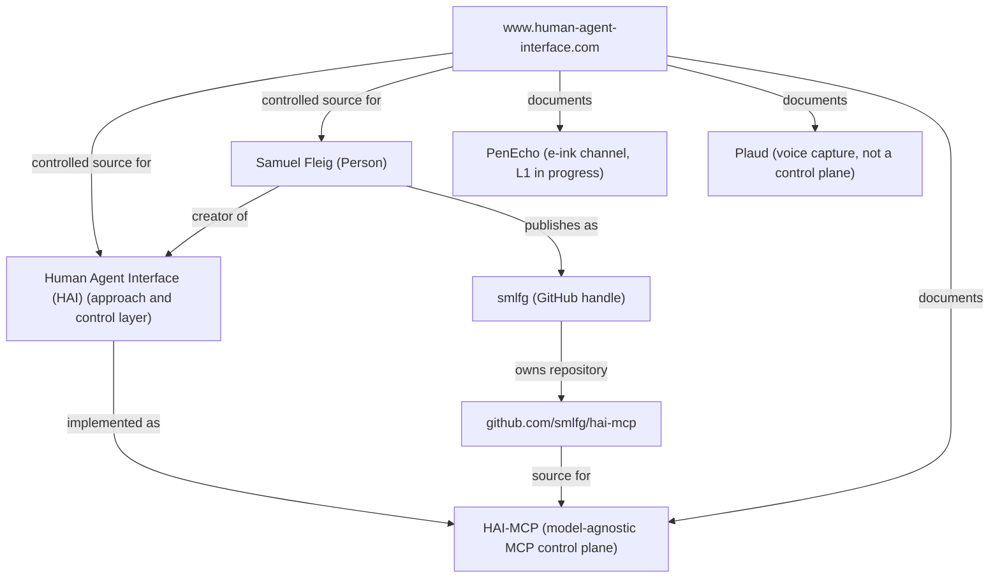

# GEO Redesign — 2026-10-30

Status: draft / handoff to the SEO agent
Date: 2026-10-30
Scope: entity definition, citation-ready copy, structured-data handoff, measurement plan, name consistency
Write scope used: `llms.txt`, `robots.txt`, this document
Not changed: the eight HTML pages, `assets/`, `src/worker.js`, `sitemap.xml`

This document does not apply page changes. It lists what the SEO agent should change and why.

Line references were checked against the working tree on 2026-10-30. Section anchors are more stable than line numbers when pages change in parallel.

Note: `HAI-GEO/**` is excluded from the deployed assets by `.assetsignore`. This file is internal unless that rule changes.

## 0. Inputs

Read for this review:

- `HAI-GEO/README.md`
- `HAI-GEO/PHASE_2_CANONICAL_ENTITY_DEFINITION_2026-09-09.md`
- `HAI-GEO/canonical-descriptions/human-agent-interface.md`
- `HAI-GEO/canonical-descriptions/was-ist-hai.md`
- `HAI-GEO/canonical-descriptions/welches-problem-loest-hai.md`
- `HAI-GEO/canonical-descriptions/no-marketing-floskeln.md`
- `HAI-GEO/canonical-descriptions/citation-ready-statements.md`
- `HAI-GEO/canonical-descriptions/hai-mcp.md`
- `HAI-GEO/entity-map/tiny-entity-map.md`
- `HAI-GEO/GEO_BENCHMARK_CATALOG.json`
- `HAI-GEO/templates/geo_measurement_scorecard.md`
- `HAI-GEO/measurements/2026-09-08_web_search_baseline.md`
- the eight redesigned pages
- the legacy entity pages that still exist in the deploy directory: `/what_it_is/`, `/proof/`, `/samuel/`, `/hai-mcp/`
- `llms.txt`, `robots.txt`, `sitemap.xml`, `wrangler.jsonc`, `.assetsignore`

## 1. Entity map for the new site



Canonical URLs:

| Page | German | English |
|---|---|---|
| Home | `https://www.human-agent-interface.com/` | `https://www.human-agent-interface.com/en/` |
| What is HAI | `https://www.human-agent-interface.com/was-ist-hai/` | `https://www.human-agent-interface.com/en/what-is-hai/` |
| Proof | `https://www.human-agent-interface.com/beweis/` | `https://www.human-agent-interface.com/en/proof/` |
| Mesh | `https://www.human-agent-interface.com/mesh/` | `https://www.human-agent-interface.com/en/mesh/` |

Entity table:

| Entity | Type | Canonical evidence | Relationship |
|---|---|---|---|
| Samuel Fleig | Person | `/` and `/en/`, person section | creator of HAI; publishes as `smlfg` |
| Human Agent Interface (HAI) | Approach and control layer | `/was-ist-hai/` and `/en/what-is-hai/` | implemented as HAI-MCP |
| HAI-MCP | Software / MCP server | `/beweis/#hai-mcp` and `/en/proof/#hai-mcp`; GitHub repository | model-agnostic MCP control-plane implementation of HAI |
| PenEcho | Software / prototype | `/beweis/#penecho` and `/en/proof/#penecho` | e-ink channel; L1 in progress |
| Plaud | External capture channel | `/beweis/#plaud` and `/en/proof/#plaud` | voice input; not a control plane |
| `human-agent-interface.com` | WebSite | `/` | controlled source for HAI and Samuel Fleig |
| `smlfg` | GitHub handle | `https://github.com/smlfg` | publishing identity of Samuel Fleig |
| `github.com/smlfg/hai-mcp` | Repository | GitHub | controlled source for HAI-MCP |

Edges the site currently supports in visible text:

| Subject | Predicate | Object | Evidence |
|---|---|---|---|
| Samuel Fleig | created | Human Agent Interface (HAI) | homepage, `/was-ist-hai/`, canonical docs |
| Human Agent Interface (HAI) | implemented as | HAI-MCP | `/beweis/`, `/was-ist-hai/` |
| Samuel Fleig | publishes as | `smlfg` | GitHub links in header/footer and person section |
| `smlfg` | owns | `github.com/smlfg/hai-mcp` | `/beweis/` source block |
| HAI-MCP | maintains | missions, contracts, leases, owner gates, audit | `/beweis/` HAI-MCP section |
| HAI-MCP | does not call | a language model | `/beweis/` HAI-MCP section |
| `human-agent-interface.com` | is controlled source for | HAI | canonicals, `llms.txt`, page copy |
| Website | documents | PenEcho, Plaud, HAI-MCP | `/beweis/` |

Graph boundaries:

- HAI is the approach and control layer. HAI-MCP is one implementation.
- PenEcho and Plaud are documented channels, not HAI on their own.
- The site states that no connected runtime joins the three parts. Do not draw that edge.
- Only `www.human-agent-interface.com` is labelled live in `/mesh/`. The other seven domains are labelled planned. Do not cite them as entities.

Legacy graph still present in the deploy directory:

- `/what_it_is/` defines HAI as an "approach" and uses `#human-agent-interface`.
- `/hai-mcp/` uses `SoftwareSourceCode` with `@id` `https://github.com/smlfg/hai-mcp#software`.
- `/samuel/` uses `Person` with `@id` `/samuel/#samuel-fleig` and four `sameAs` entries.
- The new pages use `#hai` for HAI and `/#samuel-fleig` for Samuel, with one `sameAs`.

These are two different entity graphs on the same host. See section 6.

## 2. Ten citation-ready statements

Rules used:

- One claim per sentence.
- Explicit subject; no pronoun that needs page context.
- Stable relationship verbs: is, keeps, created, maintains, does not call.
- No market, superiority or readiness claims.

### 1. Definition

- DE: Human Agent Interface (HAI) ist eine Open-Source-Kontrollschicht für menschlich verantwortete Agentenarbeit.
- EN: Human Agent Interface (HAI) is an open-source control layer for human-owned agentic AI work.

### 2. Components

- DE: HAI macht agentische Arbeit beobachtbar, begrenzt, prüfbar und menschlich verantwortet.
- EN: HAI keeps agentic work observable, bounded, verifiable and human-owned.

### 3. Problem

- DE: HAI adressiert den Kontrollverlust bei agentischer Arbeit: die Lücke zwischen Ausführung und Verantwortung.
- EN: HAI addresses the loss of control in agentic work: the gap between execution and responsibility.

### 4. Creator

- DE: Samuel Fleig hat Human Agent Interface (HAI) entwickelt.
- EN: Samuel Fleig created Human Agent Interface (HAI).

### 5. HAI-MCP relationship

- DE: HAI-MCP ist die modellunabhängige MCP-Control-Plane-Implementierung von HAI.
- EN: HAI-MCP is the model-agnostic MCP control-plane implementation of HAI.

### 6. HAI-MCP function

- DE: HAI-MCP verwaltet Missionen, Verträge, Leases, Owner-Gates und Audit; der Server ruft selbst kein Sprachmodell auf.
- EN: HAI-MCP maintains missions, contracts, leases, owner gates and audit; the server does not call a language model itself.

### 7. PenEcho

- DE: PenEcho ist ein bidirektionaler E-Ink-Algebra-Tutor, bei dem der Agent auf dieselbe Seite zurückschreiben soll; L1 ist noch in Arbeit.
- EN: PenEcho is a bidirectional e-ink algebra tutor designed to let the agent write back on the same page; L1 is still in progress.

### 8. Plaud

- DE: Plaud ist ein Spracheingang und keine Control Plane; eine Aufnahme erzeugt keinen Auftrag.
- EN: Plaud is a voice input, not a control plane; a recording does not create a task.

### 9. Boundary: HAI

- DE: HAI ist kein Chat-Interface, kein Agent-Framework und keine fertige Enterprise-Plattform.
- EN: HAI is not a chat interface, an agent framework, or a finished enterprise platform.

### 10. Boundary: HAI-MCP

- DE: HAI-MCP ist nicht das Home-Assistant-Projekt ha-mcp und kein allgemeiner MCP-Utility-Server.
- EN: HAI-MCP is not the Home Assistant project ha-mcp and not a generic MCP utility server.

## 3. Handoff: what the HTML pages should add

Do not apply these changes in this task. The SEO agent owns the eight pages.

### P0 — entity identity and crawl set

1. **Decide the canonical HAI `@id`.** The new pages use `https://www.human-agent-interface.com/#hai`. The legacy `/what_it_is/`, `/hai-mcp/` and `/samuel/` pages use `#human-agent-interface`. Pick one identifier and use it on every page whose subject is HAI.
2. **Decide the canonical Samuel Fleig `@id`.** New pages use `/#samuel-fleig`; `/samuel/` uses `/samuel/#samuel-fleig`. Use one node with one `url` and one `sameAs` set.
3. **Fix `Person.url`.** The new pages point to `https://samuelfleig.com/`, while `/mesh/` labels `samuelfleig.com` as planned. Point `url` to a live page, or bind the domain before using it. Do not publish a `url` that does not resolve.
4. **Fix the HAI `DefinedTerm.url` conflict.** The homepages and definition pages now agree per language: `#hai` points to `/was-ist-hai/` in German and to `/en/what-is-hai/` in English. The same `@id` still carries two different `url` values across languages. Either use one `url` for the concept or use language-specific `@id` values.
5. **Apply a legacy URL policy.** The current `sitemap.xml` lists the eight redesigned URLs plus Impressum and Datenschutz, all with `lastmod` 2026-10-30. This changed in the working tree during this task. The remaining task is the legacy set: `/what_it_is/`, `/proof/`, `/samuel/` and `/hai-mcp/` still exist and are no longer in the sitemap. Redirect or canonicalise them so the old definitions and `@id` values stop competing.
6. **Fix the internal HAI-MCP link.** `/was-ist-hai/` and `/en/what-is-hai/` link the HAI-MCP term card to `/mesh/` and `/en/mesh/`. The HAI-MCP section is at `/beweis/#hai-mcp` and `/en/proof/#hai-mcp`. Link there, or keep `/hai-mcp/` as the dedicated page and link that.
7. **Unify the HAI definition.** Use one canonical sentence per language in the visible definition, the meta description and the JSON-LD. The current EN page says "open-source control layer"; the DE page says "Kontrollschicht" without "Open Source".

### P1 — structured data

8. **Add a `WebPage` node to the homepage and to `/en/`.** The two homepages currently expose only `WebSite`, `DefinedTerm` and `Person`. Add `WebPage` with `@id`, `url`, `name`, `inLanguage`, `isPartOf` and `mainEntity`.
9. **Add `BreadcrumbList` to the two homepages.** The six inner pages now have it; `/` and `/en/` do not. Use the same pattern on all eight pages.
10. **Add `FAQPage` to the visible FAQ.** `/was-ist-hai/` and `/en/what-is-hai/` already have four visible questions. Mark up exactly those questions and answers. Do not add hidden FAQ content.
11. **Add a `SoftwareSourceCode` node for HAI-MCP on the proof pages.** Use `name`, `description`, `codeRepository`, `author` or `creator`, and `isPartOf` pointing to HAI. The legacy `/hai-mcp/` page already has a working node; port that pattern, then align the `@id`.
12. **Restore the creator edge in machine-readable form.** `DefinedTerm` has no `creator` property. Either model HAI as `CreativeWork` on the pages where the creator edge matters, or add a separate `CreativeWork` node with `creator` pointing to Samuel Fleig. The visible text already asserts the edge; the JSON-LD should not drop it.
13. **Add `dateModified` and `inLanguage` to every `WebPage`.** The pages carry a visible date (`30.10.2026` / `30 Oct 2026`); repeat it in machine-readable form.
14. **Use `subjectOf` or a citation list for registries.** Do not add Glama, Unyly, M8ven or Lulu to `sameAs` unless the target is provably the same software entity and points back to `github.com/smlfg/hai-mcp`.
15. **Do not model HAI as `SoftwareApplication`.** HAI is an approach and control layer; HAI-MCP is the software artifact. Use `DefinedTerm` or `CreativeWork` for HAI and `SoftwareSourceCode` for HAI-MCP.

### P1 — visible definition and boundary blocks

16. **Add one canonical definition block per page.** Place it near the top, give it a stable anchor (`#definition`), and use the exact definition sentence from section 2.1. On `/beweis/` and `/mesh/`, add a short "HAI in one sentence" block, because those pages currently explain components and domains without restating what HAI is.
17. **Add one boundary block per page.** Reuse the four boundaries already visible on `/was-ist-hai/`: not a chat interface, not prompt engineering, not a finished enterprise platform, not autonomy without limits. Keep the wording identical across pages and languages.
18. **Add an entity facts table.** Columns: entity, role, canonical URL, evidence, date. This gives answer engines a compact extraction target and gives humans a source check.
19. **Add a "Last verified" date to factual claims.** The proof page already dates the tool count and transcript count. Apply the same pattern to status claims on `/mesh/` and the homepage.

### P2 — FAQ and citation anchors

20. **Add proof FAQs.** Suggested questions, answerable from existing page text only: What is proven? What is not proven? Is HAI-MCP the same as HAI? Is PenEcho finished? Is Plaud part of HAI? Keep every answer within the current evidence.
21. **Add mesh FAQs.** Suggested questions: Which domain is canonical? Are the other domains live? Why is `agentfähig.de` not bound? Answer with the existing "live" and "planned" labels.
22. **Keep stable anchors across languages.** Recommended IDs: `#definition`, `#problem`, `#components`, `#hai-mcp`, `#penecho`, `#plaud`, `#boundaries`, `#faq`. Do not rename anchors that already exist (`#definition`, `#penecho`, `#hai-mcp`, `#plaud`).
23. **Add internal links from proof to definition.** `/beweis/` links to `/was-ist-hai/` and `/mesh/`; `/en/proof/` mirrors this. Keep those links and add one from `/mesh/` back to `/was-ist-hai/`.

### P2 — metadata

24. **Put the full entity name in title tags.** Titles such as "Der Beweis — PenEcho, HAI-MCP, Plaud | HAI" end with the abbreviation only. Prefer "… | Human Agent Interface (HAI)" so the title alone carries the entity.
25. **Keep canonicals self-referential and on `www`.** All eight pages already do this. Do not introduce a non-`www` canonical.
26. **Keep `x-default` on the German page.** The current pattern is consistent: DE pages point `x-default` to DE, EN pages point `x-default` to the DE counterpart.
27. **Do not add `llms.txt` as a `rel` value.** There is no widely supported HTML link relation for it. The file is discoverable at `/llms.txt`; `robots.txt` references it as a comment.

### Do not

- Do not add claims that are not already on the page.
- Do not turn planned domains into live entities.
- Do not add FAQ markup without visible FAQ content.
- Do not add registry URLs to `sameAs`.
- Do not add fake reviews, backlinks, ratings or customer counts.
- Do not use "enterprise-ready", "leading", "seamless" or similar wording.

## 4. How to measure GEO success with the existing tools

Existing assets:

| Tool | Path | Use |
|---|---|---|
| Benchmark catalog | `HAI-GEO/GEO_BENCHMARK_CATALOG.json` | 5 engines, 10 queries, 8 score fields, schema 1.0 |
| Scorecard template | `HAI-GEO/templates/geo_measurement_scorecard.md` | One file per run, per-query entries |
| Web-search baseline | `HAI-GEO/measurements/2026-09-08_web_search_baseline.md` | Comparable baseline for search-control queries |
| Later run | `GEO/runs/2026-09-26.md` | Prior entity-query observations; use as context, not as a controlled baseline |
| Catalog validator | `HAI-GEO/scripts/validate_geo_benchmark.py` | Structural check only |

Run the validator before a measurement round:

```bash
python3 HAI-GEO/scripts/validate_geo_benchmark.py
```

Expected output shape: `OK`, `engines=5 queries=10 score_fields=8`.

Measurement procedure:

1. Run the local parser control first. For each of the eight pages, record: title, meta description, canonical, `hreflang` set, JSON-LD `@id` values, visible definition sentence, visible boundary block.
2. Run the ten catalog queries unchanged in each engine: ChatGPT search, Gemini / Google AI Mode, Perplexity, web-search control, local parser control. Record the engine and mode visible in the UI.
3. Copy the answer excerpt and every cited URL verbatim. Do not add steering context unless the run is marked as assisted.
4. Score the eight fields: `correct_samuel_identified`, `samuel_hai_association`, `hai_definition_accuracy`, `hai_hai_mcp_association`, `correct_citations`, `wrong_person_selected`, `wrong_hai_or_hai_mcp_collision`, `hallucinated_facts`.
5. Save the run as `HAI-GEO/measurements/2026-10-30_post-redesign.md`. This file is not created here because it is outside the write scope of this task.
6. Repeat after the sitemap and JSON-LD changes. Compare against the 2026-09-08 baseline and the 2026-09-26 observations.

Success criteria, per query where the expected list includes the relation:

- `samuel_hai_association = 1`
- `hai_definition_accuracy = 2`
- `hai_hai_mcp_association = 1`
- `correct_citations = 2`
- `wrong_person_selected = 0`
- `wrong_hai_or_hai_mcp_collision = 0`
- `hallucinated_facts = 0`

For the three negative-collision queries, success means the answer distinguishes the entities and does not merge them. A high score on positive queries does not cancel a collision on a negative query.

Do not claim improvement without a comparable baseline and a retest. The catalog's own rules say this; keep it.

Secondary signal:

- Cloudflare Analytics Engine dataset `hai_site_events` (binding `HAI_SITE_EVENTS` in `wrangler.jsonc`) records site events. It measures on-site engagement, not citations or answer-engine visibility. Use it only as a supporting signal.
- There is no repository tool that measures AI citations automatically. Do not present manual observations as automated measurements.

## 5. Risks and unverified claims

| # | Risk | Where | Why it matters | Mitigation |
|---|---|---|---|---|
| 1 | Legacy pages still exist next to the new IA | `/what_it_is/`, `/proof/`, `/samuel/`, `/hai-mcp/` | The sitemap now lists the eight new URLs, but the old pages are still served by the asset layer. Search engines that already indexed them can keep returning the old definitions and `@id` values. | Add redirects or canonicals from the legacy pages to the new pages; verify each legacy URL. |
| 2 | `Person.url` points to a planned domain | `index.html` L46, `en/index.html` L46, `was-ist-hai/index.html` L63, `en/what-is-hai/index.html` L63 | The JSON-LD `url` may not resolve, and `/mesh/` says `samuelfleig.com` is planned. | Use a live URL or bind the domain first. |
| 3 | Two `@id` families for the same entities | New pages vs `/what_it_is/`, `/samuel/`, `/hai-mcp/` | Answer engines see `#hai` and `#human-agent-interface`, and `/#samuel-fleig` and `/samuel/#samuel-fleig`, as different nodes. | Pick one `@id` per entity; update all pages. |
| 4 | Definition drift between DE and EN | `was-ist-hai/index.html` L147 vs `en/what-is-hai/index.html` L147 | One language says "open-source control layer"; the other says "Kontrollschicht" without "Open Source". | Use one canonical sentence per language from section 2. |
| 5 | "Open-source" claim for HAI itself | New pages, canonical docs | The new pages link public repositories for HAI-MCP and PenEcho, but not a HAI source repository or license. | Link the public HAI repository and license if it exists; otherwise keep "open source" only for HAI-MCP. |
| 6 | `23 tools` is time-sensitive | `beweis/index.html` L258 and L449; `en/proof/index.html` L256 and L446 | The number comes from a Glama extraction dated 2026-09-08 and can change. | Keep the date and source; never present it as an audit result. |
| 7 | `223 transcripts` is an internal count | `beweis/index.html` L323 and L450; `en/proof/index.html` L321 and L447 | The page says it is not externally verified. Answer engines may drop that qualifier. | Keep the qualifier next to the number; prefer "internal count" over "proof". |
| 8 | PenEcho overclaim | `beweis/index.html` L228-L230; `en/proof/index.html` L226-L228 | The page says the seamless write-back and the colour are not proven. A summary can turn "L1 in progress" into "works". | Repeat "L1 in progress" and "not proven" near the top of the PenEcho section. |
| 9 | Plaud entity collision | `beweis/index.html` L315-L369; `en/proof/index.html` Plaud section | Plaud is an external product name. The page does not state the vendor relationship; answer engines may merge the channel with the vendor. | Describe Plaud as a third-party recording device only if that is accurate; otherwise keep "Plaud device" and avoid ownership implications. |
| 10 | HAI acronym collisions | Site-wide | `ha-mcp` (Home Assistant), HAI.AI / haiai, the Rust `hai-mcp` crate, the 2011 JIAC HAI prototype and generic human-agent-interface pages all compete for the token. | Keep the boundary statements in `llms.txt` and on `/was-ist-hai/`; require `smlfg`, the domain or the repo as resolver anchors. |
| 11 | Samuel Fleig same-name collisions | Site-wide, registries, LinkedIn | Prior audits found same-name people in professional and sports contexts. | Keep the GitHub handle and HAI context in the same sentence; do not add weak `sameAs` entries. |
| 12 | `smlfg` vs `smlflg` | `/samuel/` `sameAs`, GEO docs, local paths | A one-letter difference can split the publishing identity. The public site uses `smlfg`; Medium uses `@smlflg`; a Hugging Face namespace `smlflg` appears in prior notes. | Canonical handle is `smlfg`. If Medium stays, label it as Medium, not GitHub. Do not add the Hugging Face namespace to `sameAs`. |
| 13 | Non-`www` legacy URL | `AffeHTML/index.html` `og:url` | The eight new pages use `www`, but a legacy page uses the bare host. | Verify a 301 from non-`www` to `www`; keep `www` in all canonicals and `og:url` values. |
| 14 | Glama URL variants | `beweis/index.html` L422; `en/proof/index.html` L419; `PHASE_2` L145 | The pages use `/mcp/servers/@smlfg/hai-mcp`; the prior doc uses `/mcp/servers/smlfg/hai-mcp`. | Verify which URL resolves; use one form everywhere. |
| 15 | No independent audit and no external case study | `beweis/index.html` L387-L389; `en/proof/index.html` L385-L387 | HAI-MCP is inspectable, not audited. No external end-to-end case study exists. | Keep these as explicit gaps; do not let summaries turn inspection into validation. |
| 16 | No connected runtime | `beweis/index.html` L387; `en/proof/index.html` L385 | PenEcho, HAI-MCP and Plaud are documented separately. | Keep the "no connected runtime" sentence on the proof page and in `llms.txt`. |
| 17 | `llms.txt` and robots are not a ranking guarantee | `llms.txt`, `robots.txt` | AI crawlers may ignore both; allowing a bot does not guarantee ingestion or citation. | Measure with the catalog; do not report file changes as visibility gains. |
| 18 | Planned domains can be read as live | `mesh/index.html` L116-L125; `en/mesh/index.html` L116-L125 | Seven of eight domains are planned. A summary can drop the status column. | Keep "planned" in the same sentence as the domain; do not link planned domains. |
| 19 | Training-crawler policy is implicit | `robots.txt` | The file allows `GPTBot`, `Google-Extended` and `CCBot` together with search crawlers. These are primarily training or data crawlers; allowing them is a content-use decision, not only a visibility decision. | Confirm that the owner accepts training and data use; otherwise split the groups and allow only search crawlers. |

## 6. Consistency audit (names, URLs, signals)

Scope: the eight redesigned pages, `llms.txt`, `robots.txt`, `sitemap.xml`, and the HAI-GEO docs that define the entity. Legacy pages are included where they still exist in the deploy directory and may remain crawlable.

| # | Inconsistency | Location | Current | Canonical / recommendation |
|---|---|---|---|---|
| 1 | HAI definition: with or without "open source" | `was-ist-hai/index.html` L96 and L147; `en/what-is-hai/index.html` L96 and L147; `index.html` L7; `en/index.html` L7; `canonical-descriptions/human-agent-interface.md` L8 | DE: "Kontrollschicht zwischen Menschen und autonomen KI-Agenten". EN: "open-source control layer". Canonical doc: "open-source control layer". | Use one sentence per language from section 2. Do not let DE and EN carry different attributes. |
| 2 | `prüfbar` vs `überprüfbar` | `was-ist-hai/index.html` L147 vs L360; `canonical-descriptions/was-ist-hai.md` L8 | Body says "prüfbar"; footnote and canonical doc say "überprüfbar". | Choose one. Prefer "prüfbar" in the body and in `llms.txt`; if the canonical doc is authoritative, change the body and `llms.txt` together. |
| 3 | HAI as "approach" vs "control layer" | `/what_it_is/` L64-L74; new pages | Old page: "an approach for keeping…". New pages: "control layer". Canonical docs: "approach/control layer". | Use "approach and control layer" at first mention, then "control layer". Do not use "approach" alone as the definition. |
| 4 | HAI `@id` | `index.html` L37; `was-ist-hai/index.html` L46; `/what_it_is/` JSON-LD; `/hai-mcp/` L30-L38 | New: `#hai`. Legacy: `#human-agent-interface`. | Pick one `@id` and update every page. |
| 5 | Samuel Fleig `@id` | `index.html` L44; `was-ist-hai/index.html` L61; `/samuel/` L14-L32 | New: `/#samuel-fleig`. Legacy: `/samuel/#samuel-fleig`. | Pick one `@id`; use a live `url`. |
| 6 | Samuel Fleig `sameAs` | `index.html` L47; `/samuel/` L14-L32 | New: GitHub only. Legacy: GitHub, X, LinkedIn, Medium `@smlflg`. | Follow the Phase 2 `sameAs` policy: GitHub is strong; LinkedIn is conditional; Medium is not HAI proof. Do not let two Person nodes carry different sets. |
| 7 | Samuel Fleig bio | `/samuel/` L8-L13 and L989-L994; `canonical-descriptions/samuel-fleig.md` | Legacy: "AI Engineering student and AI engineer". Canonical: "AI engineer". | Decide whether the student status is current. Use one bio fact set on every page that remains indexed. |
| 8 | HAI-MCP `@id` | `/hai-mcp/` L39-L48; `/samuel/` L42-L49; new proof pages | Legacy page: `github.com/smlfg/hai-mcp#software`. Legacy Samuel page: `/hai-mcp/#hai-mcp`. New pages: no node. | Use one `@id`, add it to the proof pages, and keep `codeRepository` on it. |
| 9 | HAI-MCP page URL | `/hai-mcp/`; `/beweis/#hai-mcp`; `/en/proof/#hai-mcp` | Three possible targets for the same entity. | Decide whether `/hai-mcp/` stays canonical or the proof section becomes the descriptive page. Link consistently. |
| 10 | HAI-MCP term link | `was-ist-hai/index.html` L276; `en/what-is-hai/index.html` L276 | "Zur Control Plane" points to `/mesh/`; EN points to `/en/mesh/`. | Point to `/beweis/#hai-mcp` and `/en/proof/#hai-mcp`, or to `/hai-mcp/` if that page stays canonical. |
| 11 | `MCP-Control-Plane` vs `Control Plane` vs `control plane` | Site-wide | German compounds use "MCP-Control-Plane"; English uses "control plane"; some German copy uses "Control Plane" as a noun. | Acceptable if grammatical, but keep "HAI-MCP" hyphenated and use "MCP control plane" as the category phrase in English. |
| 12 | `PenEcho` device specificity | `index.html` L183; `beweis/index.html` L153 | Homepage: "reMarkable". Proof: "reMarkable Paper Pro". | Not a contradiction. Use "reMarkable Paper Pro" on first mention in the proof page; keep the homepage short. |
| 13 | `Plaud` vendor relationship | `beweis/index.html` L323; `en/proof/index.html` L321 | "Plaud ist der Spracheingang: Das Gerät nimmt auf." No vendor statement. | State the relationship only if verified. Otherwise keep "Plaud device" and do not imply that Plaud is part of HAI. |
| 14 | `smlfg` vs `smlflg` | `/samuel/` L14-L32; `HAI-GEO/GEO_*`; local paths `/home/smlflg/...` | Public GitHub: `smlfg`. Medium: `@smlflg`. Prior notes: Hugging Face `smlflg/hai-mcp-public`. Docs also contain local paths with `smlflg`. | Canonical handle is `smlfg`. Label Medium explicitly if kept. Do not use `smlflg` as a GitHub or HAI-MCP proof. Treat local paths as internal, not identity. |
| 15 | `www` vs non-`www` | Eight pages; `llms.txt`; `robots.txt`; `AffeHTML/index.html` L10 | New pages and both control files use `www`. One legacy page uses `https://human-agent-interface.com/affe/`. | Keep `www` everywhere. Verify non-`www` redirects to `www`. |
| 16 | `Human-Agent-Interface` vs `Human Agent Interface` | Repo names and local paths; public copy | Hyphenated form appears in repo/path names. Public copy uses spaces. | Use "Human Agent Interface (HAI)" in visible copy and metadata. Keep the hyphenated form for repository and filesystem names only. |
| 17 | `what_it_is` vs `was-ist-hai` | `was-ist-hai/index.html`; `what_it_is/index.html` | Old German page has an English slug; new German page has a German slug. The sitemap now lists the new page; the old page still exists. | Make the new page canonical; redirect or canonicalise the old page. |
| 18 | `proof` vs `beweis` / `en/proof` | `beweis/index.html`; `en/proof/index.html`; `proof/index.html` | The sitemap now lists `/beweis/` and `/en/proof/`; the old `/proof/` still exists. | Decide the fate of `/proof/`; redirect or canonicalise it. |
| 19 | Homepage mesh table vs `/mesh/` table | `index.html` L279-L288; `en/index.html` L279-L288; `mesh/index.html` L116-L125; `en/mesh/index.html` L116-L125 | Homepage shows six domains and says "one of eight"; `/mesh/` shows all eight. | Not false, but inconsistent. Show all eight or label the homepage table "six shown". |
| 20 | Planned domains in legal pages | `mesh/index.html` L130; `impressum/`; `datenschutz/` | Imprint and privacy policy name five of eight domains; `/mesh/` states this. | Keep the disclosure; do not cite the three unnamed domains as live. |
| 21 | Sitemap and `noindex` legal pages | `sitemap.xml` L35-L42; `impressum/index.html` L6; `datenschutz/index.html` L6 | The sitemap lists Impressum and Datenschutz, but both pages carry `robots: noindex`. | Remove the two legal URLs from the sitemap or remove `noindex`; do not signal both. |
| 22 | Benchmark output paths | `GEO_BENCHMARK_CATALOG.json` L136-L138; `PHASE_2` L226 | Absolute paths under `/home/smlflg/...` do not match this machine. | Use repo-relative paths or update them before the next run. |
| 23 | Old `llms.txt` links | Previous `llms.txt` | Linked `/agentfaehig/`, `/ch/`, `/tutorials/`, `/what_it_is/`, `/proof/`, `/hai-mcp/`, `/samuel/`. | Replaced with the eight redesigned pages; deploy the new file and verify it is served at `/llms.txt`. |
| 24 | Title suffix uses only "HAI" | `beweis/index.html` L6; `en/proof/index.html` L6; `mesh/index.html` L6; `en/mesh/index.html` L6 | Titles end with the abbreviation HAI only. | Prefer the full name "Human Agent Interface (HAI)" in the title suffix so the title alone resolves the entity. |
| 25 | `og:type` inconsistency | `en/what-is-hai/index.html` L13; `beweis/index.html` L12; `mesh/index.html` L12 | What-is-HAI uses `article`; proof and mesh use `website`. | Not a naming error, but align page types: `article` for definition pages, `website` for hub pages, or use `WebPage` in JSON-LD consistently. |

## 7. What changed in this task

- `llms.txt` rewritten for the eight-page site: one entity definition per language, canonical URLs, four pages per language, key facts, reported figures with dates and qualifiers, boundaries, status and sources.
- `robots.txt` extended with explicit allow groups for `GPTBot`, `OAI-SearchBot`, `ClaudeBot`, `PerplexityBot`, `Google-Extended` and `CCBot`; sitemap kept; `llms.txt` referenced in a comment.
- This document added as the GEO handoff. No HTML page, asset or worker change was made. The sitemap changed in the working tree during this task, but not by this task; the current state is reflected above.

## 8. Next actions

1. SEO agent: resolve P0 items 1-7 before the next deploy.
2. SEO agent: confirm the new `sitemap.xml`, apply the legacy URL policy, and resolve the `noindex` legal-page conflict.
3. SEO agent: add the JSON-LD nodes from P1 and the visible definition/boundary blocks.
4. GEO: run the ten catalog queries after the deploy, write `HAI-GEO/measurements/2026-10-30_post-redesign.md`, and compare against the 2026-09-08 baseline.
5. Owner: decide whether `samuelfleig.com` is bound, whether `/samuel/` stays a canonical person page, and whether `/hai-mcp/` stays the HAI-MCP page.
6. Owner: decide whether the live commercial and tutorial pages (`/agentfaehig/`, `/ch/`, `/tutorials/`) belong under `llms.txt` Optional. The new file intentionally lists only the eight redesigned pages.
